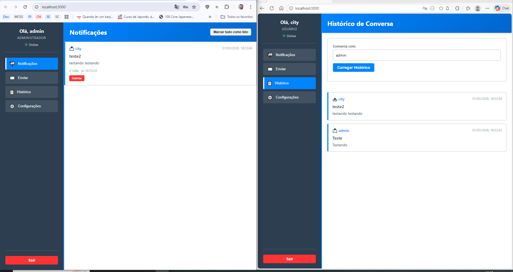

# Sistema de notificações em tempo real

Projeto pessoal de estudo que conecta autenticação, persistência SQLite e eventos Socket.IO a uma interface web. Foi construído a partir de um desafio de desenvolvimento.

## Fluxo

```text
Usuário autenticado → API Express → SQLite
                              ↓
                         Socket.IO
                              ↓
                  Interface e notificações
```

O backend inclui rotas de autenticação, usuários e notificações. A interface possui módulos de sessão, notificações, áudio e conexão em tempo real.

## Stack

- Node.js, Express e Socket.IO.
- SQLite com `better-sqlite3`.
- JWT e bcryptjs para autenticação.
- HTML, CSS e JavaScript no frontend, servido pelo próprio backend.
- Integração de tradução via MyMemory descrita em [`DEPENDENCIES.md`](DEPENDENCIES.md).

## Executar localmente

Confira as dependências nativas e a configuração exigida pelo backend. A dependência `better-sqlite3` pode exigir ferramentas de compilação e uma versão compatível do Node.

```sh
cd backend
npm install
npm start
```

O servidor utiliza `PORT` quando configurada; o padrão no código é `http://localhost:3000`. O modo de desenvolvimento está disponível por `npm run dev`.

Há Dockerfile e arquivos Compose no repositório. O Dockerfile atual usa uma base Node 18, que precisa ser revisada antes de uma nova publicação. Esta atualização documental não atualiza dependências nem certifica a imagem.

## Mapa do código

- `backend/server.js`: servidor HTTP, frontend estático e integração de eventos.
- `backend/routes/`: autenticação, usuários e notificações.
- `backend/models/` e `backend/utils/database.js`: acesso e persistência.
- `frontend/js/`: interface, sessão, áudio e Socket.IO.
- `database/schema.sql`: estrutura do banco.

## Limites da demonstração

Projeto de estudo; não é uma plataforma de atendimento corporativo. O manifesto do backend inspecionado tem scripts de execução e desenvolvimento, mas não uma suíte automatizada configurada. Esta revisão do README não executou o sistema nem comprovou comportamento em produção.



[Portfólio](https://phcgv.vercel.app/) · [LinkedIn](https://www.linkedin.com/in/phcgv/)
